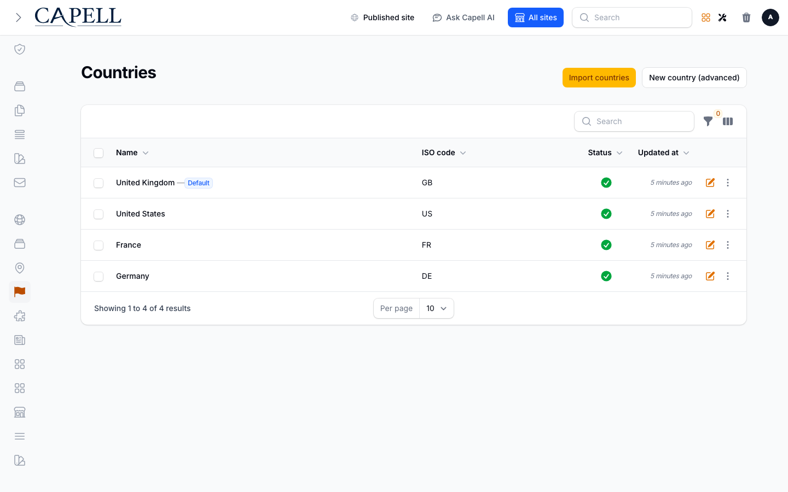
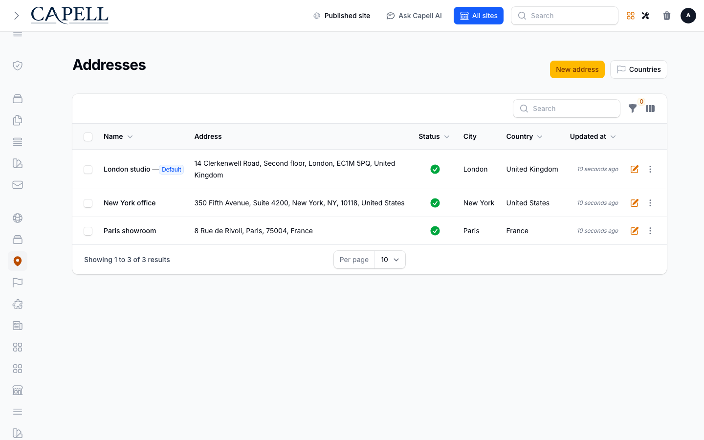

# Address

<!-- prettier-ignore-start -->

If you run more than one site from the same admin, the same office address tends to get typed more than once, a little differently each time. This gives you one list of postal addresses and countries to pick from, and each site chooses its address from that list in its own settings.

Visitors won't notice anything new. All of this happens in your admin, nothing is added to your public pages, and postcode lookup and maps aren't part of it.

What you get is tidier records. A health check warns you when two addresses look like the same place spelled two ways, or when an address has no enabled country. When two of your sites share an office and one of them moves, edit the address from that site's settings. That site gets its own copy to change, and the other site's address stays as it was.

Capell has no built-in list of countries. You upload one as a CSV file (a simple spreadsheet format) of country names and their two- and three-letter codes, or add a country by hand. Before anything is saved, you see what the upload would add or switch off.

- **Price and availability:** Check current availability and price on the [Capell Marketplace listing](https://capell.app/marketplace/extensions/address).
- **Licence:** Check the licence terms on the [Capell Marketplace listing](https://capell.app/marketplace/extensions/address).
- **Requires:** `PHP ^8.4`, `capell-app/admin ^1.0.78`, `capell-app/core ^1.0.78`, `stijnvanouplines/blade-country-flags ^1.0`.
- **Install:** `composer require capell-app/address:@beta`.

## Quick Start

1. Install the package: `composer require capell-app/address:@beta`.
2. Run the package setup: `php artisan capell:address-install`.
3. See it working: run `php artisan capell:address-demo`.
4. Open the package admin surface at `/admin/address/countries` and confirm Address is available.

## For Developers

The package contributes AddressResource, CountryResource, reusable form fields, and a site schema extender instead of making each package model location fields again.

## Configure

- **Configuration files:** `config/capell-address.php`.
- **Commands:** `php artisan capell:address-blind-index-rehash`, `php artisan capell:address-countries-import`, `php artisan capell:address-demo`, `php artisan capell:address-faker`, `php artisan capell:address-geocode-normalize`, `php artisan capell:address-install`.

## Limits And Pitfalls

- Install the required Capell packages at the versions in `composer.json`: `capell-app/admin ^1.0.78`, `capell-app/core ^1.0.78`.
- Run migrations before opening package resources or public routes.

## Screens And Workflow

- Countries admin index (admin).
- Addresses admin index (admin).
- Create/edit country form (admin).
- Create/edit address form (admin).
- Site settings fields where address data is injected (admin).
- Countries admin index with admin sidebar menu open (admin).

## Install Impact

- Required packages: `capell-app/admin`, `capell-app/core`.
- Admin navigation: declares `admin-resource: AddressResourceContribution`, `admin-resource: CountryResourceContribution`; each Filament page or resource controls its own navigation visibility.
- Admin/editor extensions: `configurator: AddressConfiguratorsContribution`, `schema-extender: AddressSiteSchemaExtenderContribution`.
- Permissions: access also governed by package policies: `AbstractAddressResourcePolicy`, `AddressPolicy`, `CountryPolicy`.
- Public routes: none declared.
- Database changes: package migrations are declared.
- Config: `config/capell-address.php`.
- Settings: no package settings declared.
- Queues or schedules: none declared.
- Cache tags: none declared.
- Commands: `capell:address-blind-index-rehash`, `capell:address-countries-import`, `capell:address-demo`, `capell:address-faker`, `capell:address-geocode-normalize`, `capell:address-install`.

## Troubleshooting

| Symptom | Likely cause | Check | Fix |
| --- | --- | --- | --- |
| Package surface is missing after install | Provider or manifest is not loaded | Confirm `capell.json`, package `composer.json`, and provider registration | Reinstall the package, refresh Composer autoload, and clear host caches |
| Admin screen or command fails on missing table | Package migrations have not run | Check the tables listed in `Data Model` | Run host migrations and rerun the focused package test |

## Upgrading

No manual steps between minor versions.

Read [CHANGELOG.md](CHANGELOG.md) before upgrading.

## Next Steps

- [Package docs](docs/README.md)
- [Overview](docs/overview.md)
- [Worked extension examples](docs/extension-contracts.md)
- [Admin guide](docs/admin-guide.md)
- Configuration files: [`config/capell-address.php`](config/capell-address.php).
- [Troubleshooting](#troubleshooting)
- [Developer reference](docs/reference.md)
- [Marketplace assets](docs/assets/marketplace/)
- [Capell content language plan](../../docs/CONTENT_LANGUAGE_PLAN.md)
- [Capell documentation design system](../../docs/DESIGN_SYSTEM.md)
- [Capell and package ERD notes](../../docs/erd/capell-and-package-erds.md)
- Related packages: [Bookings](../bookings/README.md), [Events](../events/README.md), [Privacy Centre](../privacy-center/README.md).

<!-- prettier-ignore-end -->
